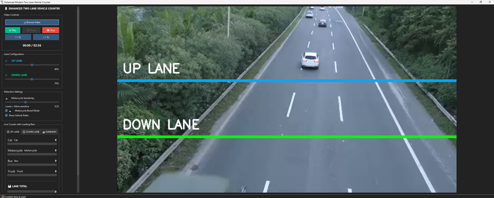

# YOLOv8 Two-Lane Vehicle Counter

## 📌 Project Background
Traffic monitoring is a critical component of urban transport management. For agencies like Prasarana, understanding vehicle flow on roads and around depots directly informs route planning, scheduling, and infrastructure decisions.

This project is a **real-time vehicle counting system** that uses computer vision and deep learning to detect, track, and count vehicles crossing two defined lanes in a video feed. It provides a practical, offline tool for extracting traffic data without relying on expensive sensor infrastructure.

## 🎯 Key Features
- **Object Detection:** Uses YOLOv8 (via Ultralytics) to detect cars, motorcycles, buses, and trucks.
- **Multi-Object Tracking:** Integrated ByteTrack algorithm to maintain vehicle identities across frames.
- **Occlusion Handling:** Predicts positions of vehicles temporarily hidden from view using velocity estimation.
- **Two-Lane Counting:** Configurable lines for counting UP and DOWN traffic separately.
- **Motorcycle Boost Mode:** A secondary low-confidence detection pass specifically to catch motorcycles, which are often missed by standard detectors.
- **Modern GUI:** Built with Tkinter and ttkbootstrap, featuring live progress bars, lane configuration sliders, and real-time counts.
- **Data Export:** Exports all counts to CSV for further analysis in tools like Excel or Power BI.

## 📸 Screenshot

## 🛠️ Tech Stack
- **Computer Vision:** OpenCV, Ultralytics YOLOv8
- **Tracking:** ByteTrack
- **GUI:** Tkinter, ttkbootstrap
- **Data Handling:** Pandas, NumPy

## 📂 Project Structure
